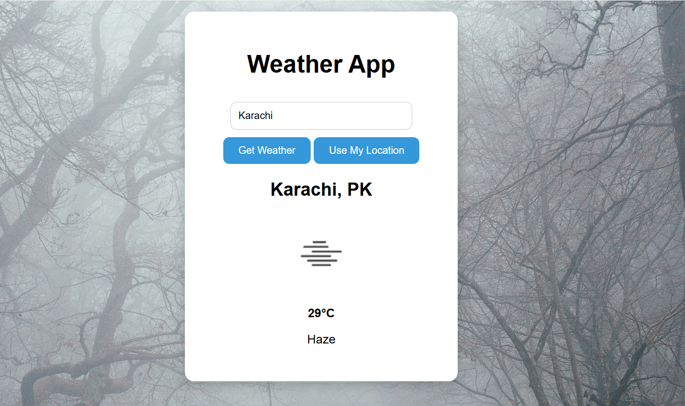
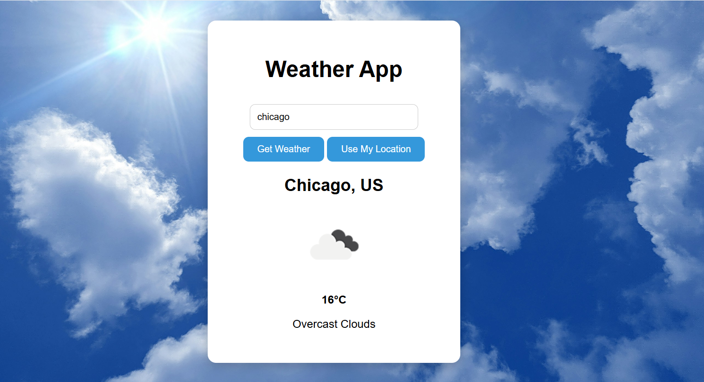
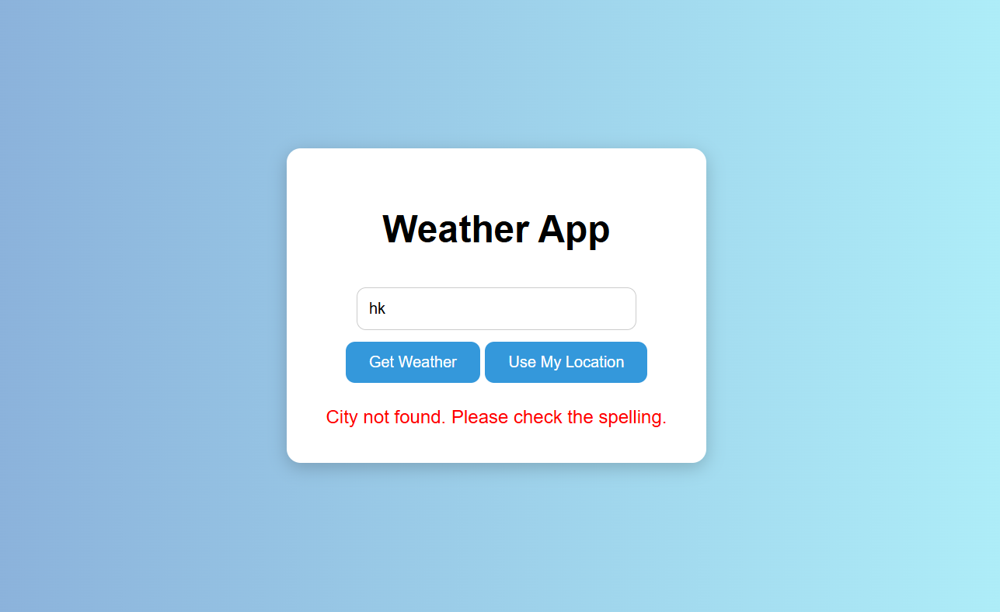

# 🌤️ Weather App
 
A weather app built with HTML, CSS, and JavaScript. Search for any city, or let the app use your device's location, and instantly see the current weather. The background image changes to match the weather conditions.
 
**🔗 Live demo:** https://weather-app-1pdq-git-main-syed-ahsan-s-projects.vercel.app
 




 
## ✨ Features
 
- 🔍 **Search by city:** type a city name and click **Get Weather** (or just press Enter)
- 📍 **Use My Location:** detects your device's location (with your permission) and shows the weather where you are
- 🖼️ **Dynamic backgrounds:** the background image changes for each weather condition: clear, clouds, rain/drizzle, thunderstorm, snow, and mist/fog/haze, with a default image for anything else
- 🌡️ **Weather details:** shows the city and country, a weather icon, the temperature in °C, and a short description
- ⚠️ **Error handling:** friendly messages for an empty search, a city that isn't found, a browser without geolocation support, or denied location access
- 🔒 **Hidden API key:** requests go through a serverless function, so the OpenWeather key is never exposed in the browser
## 🛠️ Built With
 
- HTML
- CSS
- JavaScript (`async/await` and `fetch`)
- [OpenWeather API](https://openweathermap.org/api) for live weather data
- Browser Geolocation API for the "Use My Location" button
- [Vercel](https://vercel.com) for hosting and the serverless function
## 📁 Project Structure
 
```
├── api/
│   └── weather.js     # Serverless function that calls OpenWeather
├── Images/            # Background images for each weather condition
├── index.html         # Page structure
├── style.css          # Styling
└── script.js          # App logic
```
 
## 🔐 How the API Key Is Kept Safe
 
The browser never talks to OpenWeather directly. Instead:
 
1. `script.js` sends a request to `/api/weather` (with a city name or coordinates).
2. The serverless function in `api/weather.js` reads the secret key from an environment variable (`OPENWEATHER_API_KEY`).
3. It calls OpenWeather and sends the weather data back to the page.
This way the API key stays on the server and can't be copied from the browser's dev tools.
 
## 🚀 Getting Started
 
To run the project on your own computer:
 
1. **Clone the repository**
```bash
   git clone https://github.com/your-username/your-repo-name.git
   cd your-repo-name
```
 
2. **Get a free API key** from [OpenWeather](https://openweathermap.org/api)
3. **Install the Vercel CLI** (needs [Node.js](https://nodejs.org))
```bash
   npm install -g vercel
```
 
4. **Add your API key** by creating a file named `.env` in the project folder:
```
   OPENWEATHER_API_KEY=your_api_key_here
```
 
5. **Start the app**
```bash
   vercel dev
```
   Then open the local link it shows in your terminal.
 
> Opening `index.html` directly won't work, because the app needs the `/api/weather` function to run.
 
## 🌐 Deploying to Vercel
 
1. Push the project to GitHub.
2. Import the repository into [Vercel](https://vercel.com).
3. In **Settings → Environment Variables**, add `OPENWEATHER_API_KEY` with your key.
4. Deploy.
## 📖 How It Works
 
1. The user types a city name, or clicks **Use My Location**.
2. `script.js` calls `/api/weather` using `fetch`.
3. The serverless function gets the data from OpenWeather and returns it.
4. The app reads the temperature, description, icon, and weather type from the data.
5. `getBackground()` picks the background image that matches the weather type, and the page updates.
For the location button, the browser asks the user for permission first. If they say no, the app shows a message instead of breaking.
 
## 📚 What I Learned
 
- Fetching data from an API and working with JSON
- Using `async/await` and handling errors when requests fail
- Using the browser's Geolocation API and handling denied permissions
- Keeping an API key secret with a Vercel serverless function and environment variables
- Updating the DOM and changing styles dynamically based on data
## 🔮 Future Improvements
 
- Switch between °C and °F
- Show a multi-day forecast
- Add more details (humidity, wind speed)
- Show more specific error messages (for example, when the API limit is reached)
## 👤 Author
 
**Syed Muhammad Ahsan**
Software Engineer, Front-end Web Development
 
- GitHub: https://github.com/syedAhsan382/Weather-app
- LinkedIn:https://www.linkedin.com/in/syed-muhammad-ahsan-263ab8351/ 
Feedback and suggestions are welcome! 😊
